# Services Marketplace

**A two-sided marketplace for local home services, with payments held in escrow until the job is done.**

Customers post a job, verified local professionals bid on it, and the customer picks the offer that fits. The customer's money is held by Stripe and only reaches the provider once the work is confirmed. That protects both sides.


---

## Contents

- [The business idea](#the-business-idea)
- [Screenshots](#screenshots)
- [How it works](#how-it-works)
- [Features](#features)
- [Tech stack](#tech-stack)
- [Architecture](#architecture)
- [Getting started](#getting-started)
- [Configuration](#configuration)
- [Security](#security)
- [Testing](#testing)
- [API overview](#api-overview)
- [Roadmap and known limitations](#roadmap-and-known-limitations)

---

## The business idea

### The problem

Finding someone reliable for a small job, such as a leaking tap, a ceiling light or an end-of-lease clean, still runs on word of mouth and phone calls. Both sides carry risk:

- **Customers** cannot compare prices easily. They often pay up front with no guarantee the work will be finished.
- **Providers** spend time on quotes that go nowhere. After the work is done, they can wait a long time to be paid, or never be paid at all.

### The solution

Services Marketplace puts the whole job on one platform, from request to payout:

1. **Competitive bidding.** A customer describes the job once and receives several priced offers from nearby providers.
2. **Escrow payments.** When a bid is accepted, the customer's card is authorised and the funds are *held*, not paid out. The provider can see the money is there before starting.
3. **Release on confirmation.** The provider is paid when the work is confirmed. If the customer doesn't respond, the funds are released automatically after 72 hours. If something goes wrong, a dispute freezes the money until an admin decides.
4. **Reputation.** Reviews, ratings and verification badges help good providers win more work.

### Revenue model

The platform takes a **commission on every job paid through escrow**. The default rate is 12% and can be configured with `PLATFORM_FEE_PERCENT`. The commission goes down as a provider builds trust, which gives providers a reason to keep their work on the platform:

| Provider tier | Requirements | Platform fee | Badge |
| --- | --- | --- | --- |
| Standard | Not verified | **12%** | – |
| Verified | Identity verified by an admin | **11%** | Verified |
| Trusted | Verified, rating ≥ 4.5, 10+ jobs | **10%** | Top Rated |
| Elite | Verified, rating ≥ 4.8, 20+ jobs | **8%** | Elite Pro |

Payouts go to each provider's **Stripe Connect** account. The platform keeps the fee, and Stripe handles card data and compliance.

### Who uses it

| Role | Client | What they do |
| --- | --- | --- |
| **Customer** | Mobile app | Posts jobs, compares bids, pays into escrow, chats, confirms and reviews |
| **Provider** | Mobile app | Finds nearby jobs, bids, does the work, gets paid, builds a reputation |
| **Admin** | Web dashboard | Verifies providers, manages categories, monitors payments and resolves disputes |

---

## Screenshots

> Captured from the local development build, with the demo data described in [Demo accounts](#demo-accounts).

### Customer app

<table>
  <tr>
    <td align="center">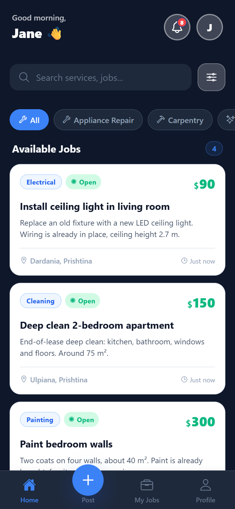<br><sub>Home</sub></td>
    <td align="center">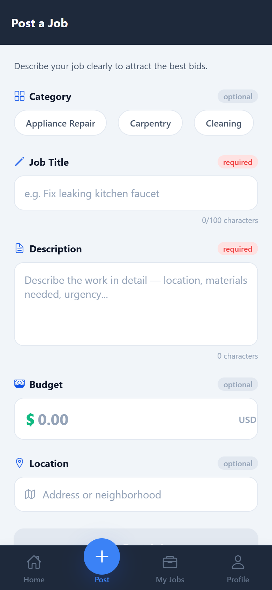<br><sub>Post a job</sub></td>
    <td align="center">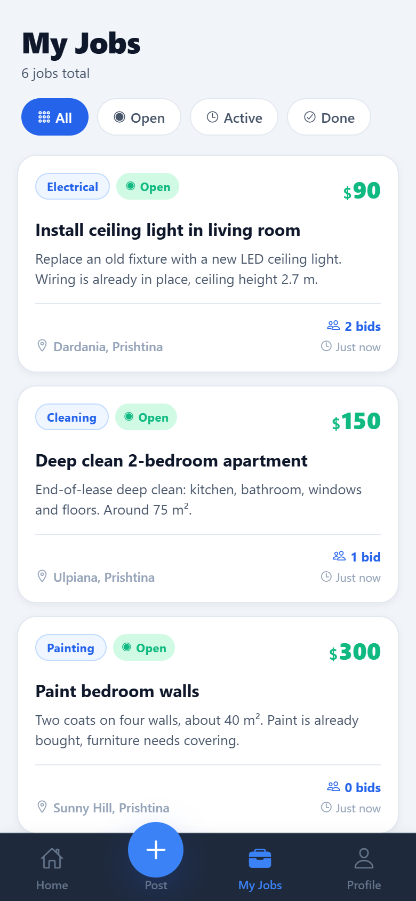<br><sub>My jobs</sub></td>
  </tr>
  <tr>
    <td align="center">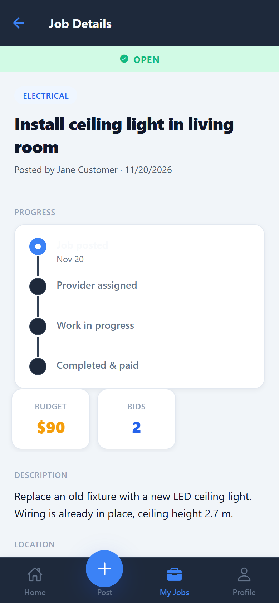<br><sub>Job details and progress</sub></td>
    <td align="center">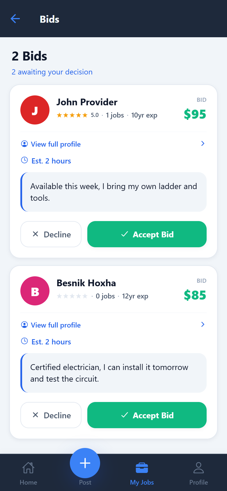<br><sub>Compare bids</sub></td>
    <td align="center">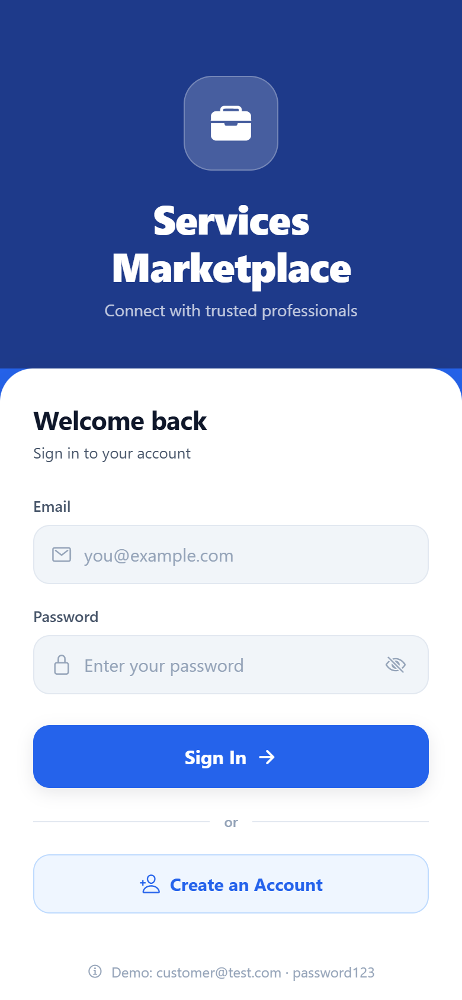<br><sub>Sign in</sub></td>
  </tr>
</table>

### Provider app

<table>
  <tr>
    <td align="center">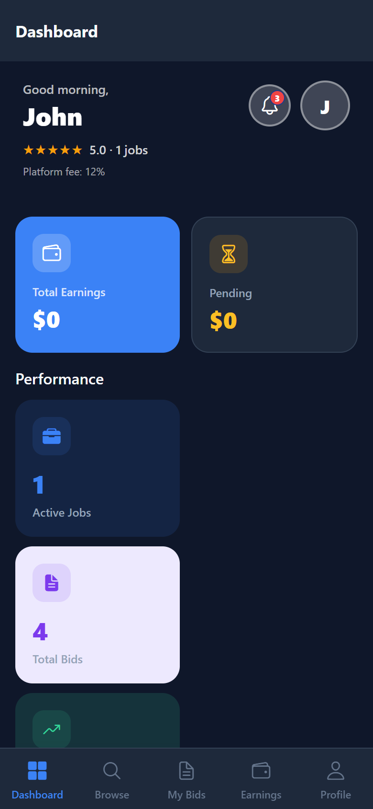<br><sub>Dashboard</sub></td>
    <td align="center">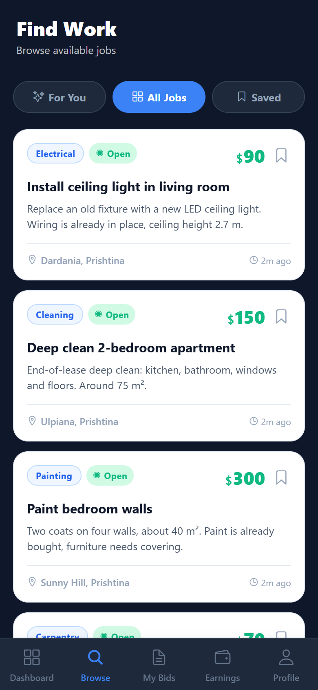<br><sub>Browse jobs</sub></td>
    <td align="center">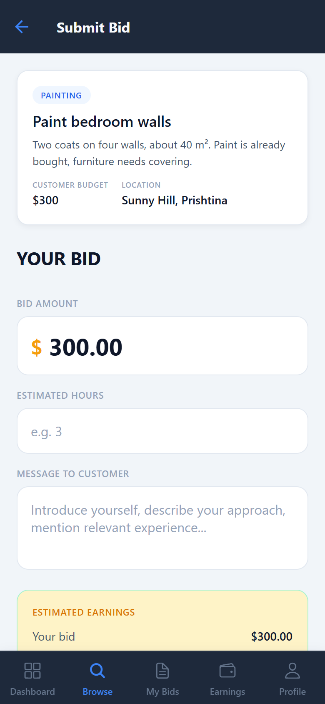<br><sub>Submit a bid</sub></td>
  </tr>
  <tr>
    <td align="center">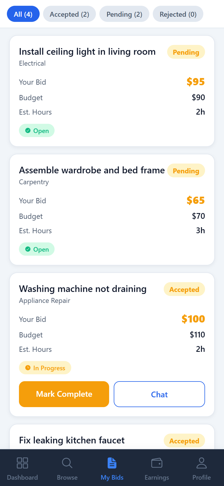<br><sub>My bids</sub></td>
    <td align="center">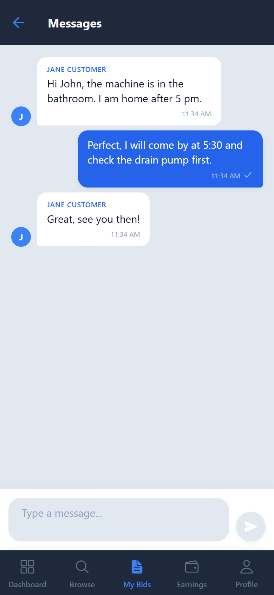<br><sub>Real-time chat</sub></td>
    <td align="center">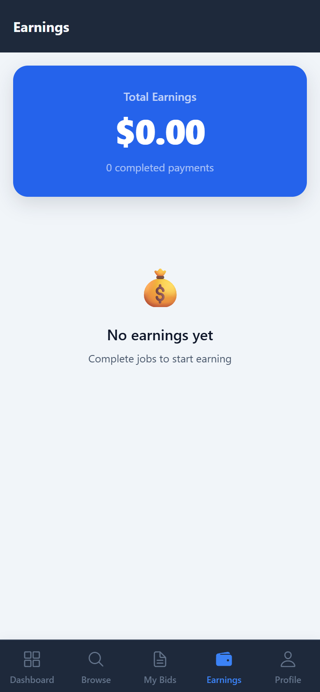<br><sub>Earnings</sub></td>
  </tr>
</table>

### Admin dashboard

| Overview | Users and verification |
| --- | --- |
| 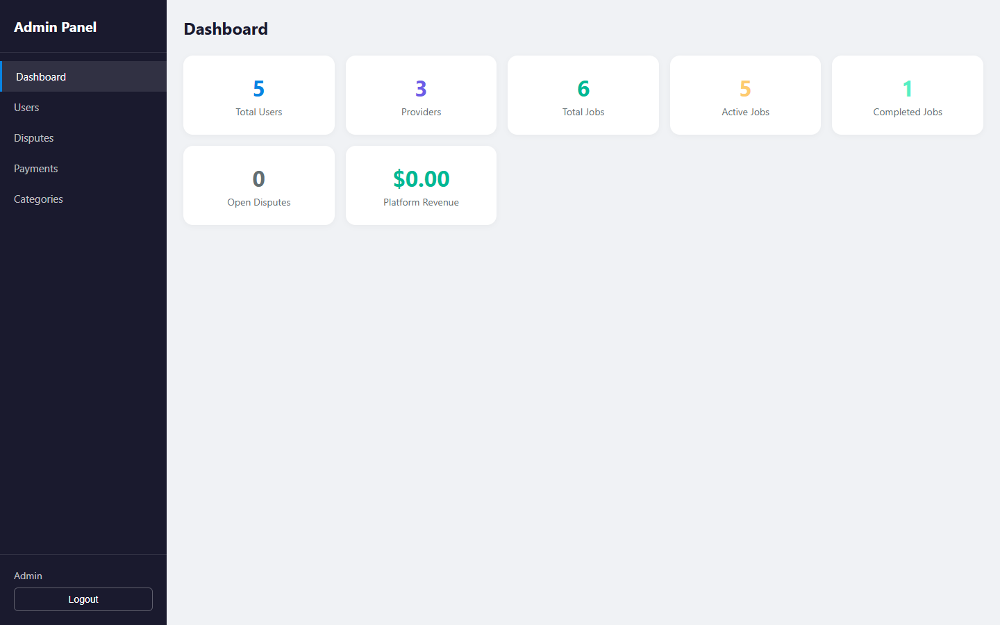 | 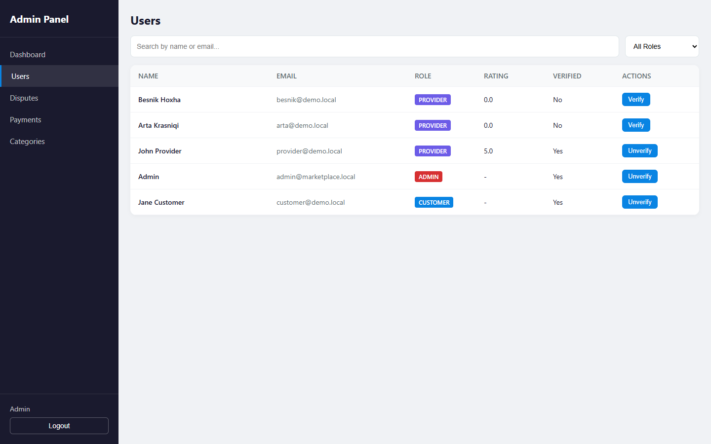 |
| **Payments and escrow** | **Service categories** |
| 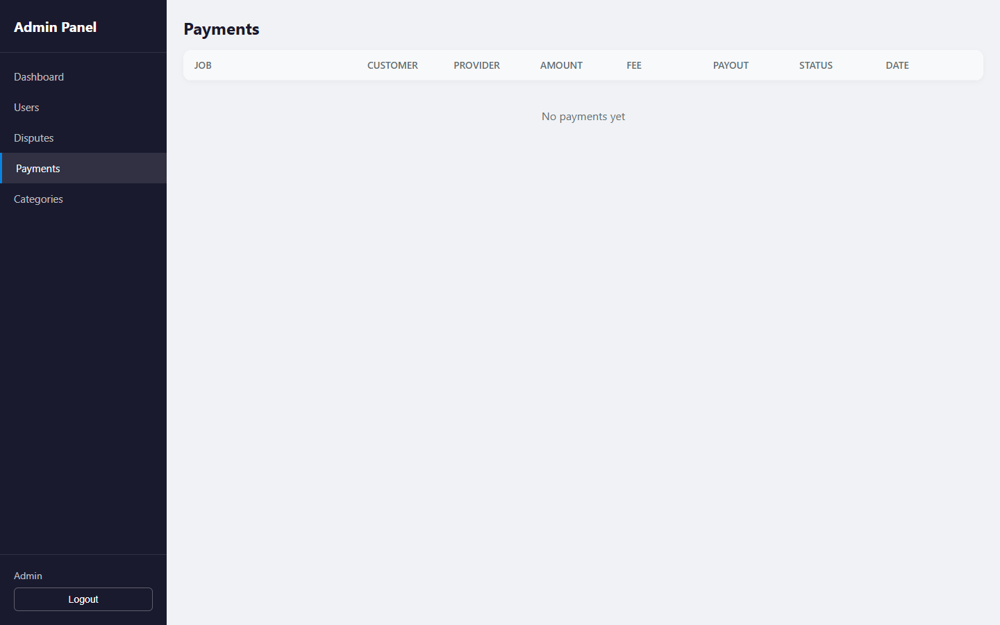 | 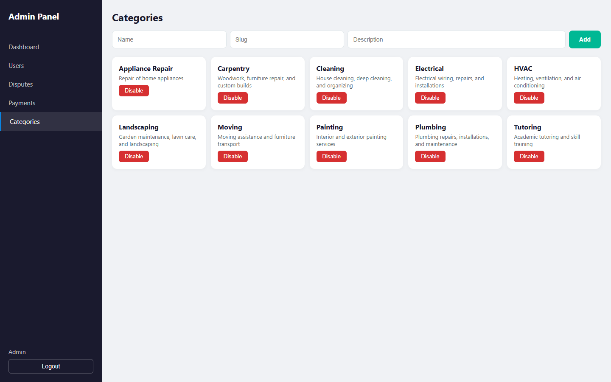 |

---

## How it works

### Job lifecycle

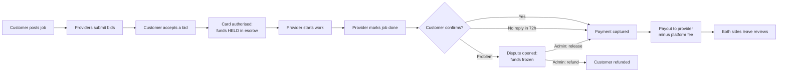

Step by step:

1. **Post.** The customer creates a job with a title, description, category, budget, location and optional photos.
2. **Bid.** Providers send a price, an estimated duration and a message. The customer sees each provider's rating, badge and completed jobs.
3. **Accept.** The customer accepts one bid. The other bids are rejected automatically and the job is assigned.
4. **Hold funds.** A Stripe PaymentIntent is created with `capture_method: manual`. The card is authorised but not charged, and the payment moves to `held`.
5. **Do the work.** The provider starts the job and the two sides coordinate in a real-time chat tied to the job.
6. **Complete.** The provider marks the job done and the customer confirms. The capture and the payout to the provider's Stripe Connect account happen together.
7. **Auto-release.** If the customer never confirms, an hourly job releases payments that have been held for more than **72 hours**. Providers are not left waiting forever.
8. **Dispute.** Either side can open a dispute. This blocks the release until an admin resolves it with a refund or a release. See the [known limitations](#roadmap-and-known-limitations) for how resolution currently settles with Stripe.
9. **Review.** After completion, both sides can leave a 1–5 star review. Reviews feed the provider's rating, badge and fee tier.

### Payment states

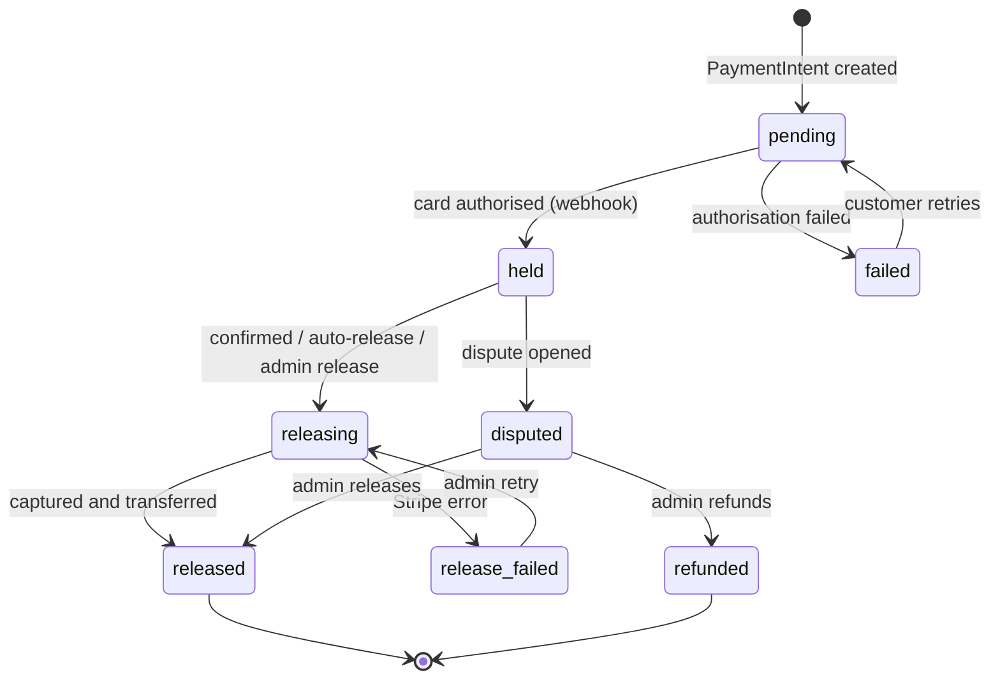

| Status | Meaning |
| --- | --- |
| `pending` | PaymentIntent created, card not yet authorised |
| `held` | Funds authorised and held, either from the `payment_intent.amount_capturable_updated` webhook or verified with Stripe on release |
| `releasing` | Release claimed; capture and provider transfer in progress |
| `released` | Captured and paid out to the provider |
| `release_failed` | Capture or transfer failed. Shown to admins with a **Retry** action |
| `failed` | Authorisation failed; the customer can retry |
| `disputed` | Dispute open. Release is blocked |
| `refunded` | Authorisation cancelled or refunded to the customer |

**Reliability guarantees**

- Creating a payment is idempotent: one row per job, plus Stripe idempotency keys.
- Release never calls Stripe inside a database transaction.
- A release interrupted midway stays `releasing` and is picked up again by the hourly escrow job. The retried capture and transfer reuse the same idempotency keys, so a job can never be charged or paid out twice.

### Payment modes

Each job has a `payment_mode`, which an admin can change through the API:

| Mode | Behaviour |
| --- | --- |
| `online_escrow` (default) | Full Stripe escrow flow described above |
| `cash` | Paid in person. The platform tracks the job but does not touch money |
| `manual` | Settled outside the platform, for example by bank transfer, and recorded by an admin |

---

## Features

**Customers**
- Post jobs with category, budget, location and photos
- Compare bids with provider rating, badge and history
- Accept or reject bids; cancel open jobs
- Escrow payment with confirmation on completion
- Real-time chat for each job, in-app and push notifications
- Save jobs, review providers, open disputes

**Providers**
- Dashboard with earnings, pending payouts, active jobs and bid stats
- Browse jobs: *For You* (recommended by skills) and *All Jobs*, with distance-based nearby search
- Submit bids with a live estimate of earnings after the platform fee
- Track bids and active jobs, mark work as done
- Earnings history and a public provider profile with reviews and badge

**Admins**
- Platform metrics: users, jobs, revenue and payment status
- User management: search, filter by role, verify or unverify providers, suspend accounts through the API
- Payment monitoring with a retry for failed releases
- Dispute resolution (refund or release)
- Service category management

**Platform**
- JWT access tokens (15 min) with rotating refresh tokens (7 days)
- Suspended accounts are blocked on every request and on the socket handshake, even with an older token
- Socket.IO rooms for each job and each user, for live chat and notifications
- Expo push notifications
- Rate limiting that is shared through Redis when it is configured

---

## Tech stack

| Layer | Technology |
| --- | --- |
| **API** | Node.js, Express 4, Joi validation, Helmet, express-rate-limit (+ Redis store), Winston logging, Multer uploads |
| **Database** | MySQL 8 through `mysql2` (pooled, parameterised queries) |
| **Realtime** | Socket.IO 4, with JWT-authenticated handshake |
| **Payments** | Stripe PaymentIntents with manual capture (escrow), Stripe Connect transfers, signed webhooks |
| **Mobile app** | React Native 0.76 with Expo SDK 52, Redux Toolkit, React Navigation, Axios, socket.io-client. Runs on iOS, Android and the web through `react-native-web` |
| **Admin dashboard** | React 18 and Vite 5, served by nginx in Docker |
| **Notifications** | Expo Server SDK (push) plus in-app notifications |
| **Infrastructure** | Docker Compose (MySQL 8, Redis 7, API, admin) |
| **Testing** | Node's built-in test runner (`node --test`) |

---

## Architecture

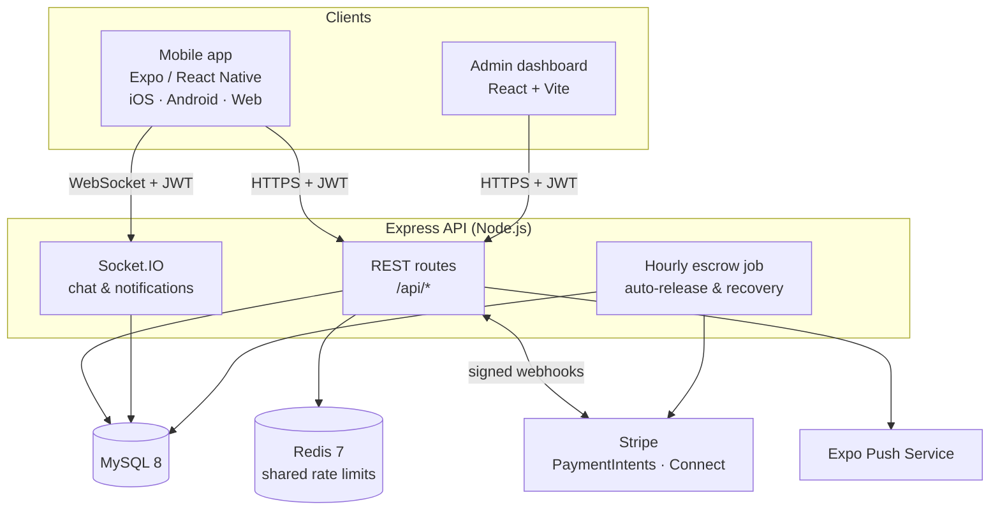

### Repository structure

```text
Services-Marketplace/
├── backend/                 Express API
│   ├── src/
│   │   ├── config/          Environment parsing and validation
│   │   ├── controllers/     Request handlers per domain
│   │   ├── database/        Migrations (v1–v5) and seed script
│   │   ├── middleware/      Auth, role checks, validation, errors, uploads
│   │   ├── routes/          Route definitions per domain
│   │   ├── services/        Escrow, payment state, reputation, geo, notifications
│   │   ├── sockets/         Socket.IO auth and chat handlers
│   │   ├── validators/      Joi schemas
│   │   ├── app.js           Express app (security headers, CORS, rate limits)
│   │   └── server.js        HTTP + Socket.IO server, scheduled jobs
│   └── test/                Unit tests
├── admin/                   React + Vite admin dashboard
├── mobile/                  Expo / React Native app
│   └── src/
│       ├── screens/         customer/, provider/, shared/
│       ├── store/           Redux Toolkit slices
│       ├── navigation/      Role-based navigators
│       └── config.js        API / socket URL resolution
├── docs/screenshots/        Images used in this README
└── docker-compose.yml       MySQL, Redis, API and admin
```

---

## Getting started

### Prerequisites

- Node.js 18 or newer and npm
- MySQL 8 (local or through Docker)
- Optional: Docker with the Compose plugin, Redis 7, a Stripe test account, and the Expo Go app for testing on a device

### Option A: Docker Compose (API, admin, MySQL, Redis)

```bash
cp .env.example .env
```

Edit `.env`: replace both password placeholders with unique local values, and set `JWT_SECRET` and `JWT_REFRESH_SECRET` to two **different** random values. The API refuses to start without them. To generate a value:

```bash
node -e "console.log(require('crypto').randomBytes(48).toString('hex'))"
```

```bash
docker compose up --build
```

Then create the schema and demo data inside the API container:

```bash
docker compose exec backend npm run migrate
```

```bash
docker compose exec backend npm run seed
```

| Service | URL |
| --- | --- |
| API | http://localhost:3000/api |
| Admin dashboard | http://localhost:3001 |
| MySQL | localhost:3306 |
| Redis | localhost:6379 |

The mobile app is not part of Compose. Run it with Option B, step 3.

### Option B: Run each part locally

**1. API**

```bash
cd backend
npm ci
cp .env.example .env      # set DB_*, JWT secrets, Stripe test keys
npm run migrate           # applies migrate.js → migrate_v5.js in order; safe to re-run
npm run seed              # categories + demo accounts
npm run dev               # http://localhost:3000
```

**2. Admin dashboard**

```bash
cd admin
npm ci
npm run dev               # Vite dev server
```

The dashboard calls `http://localhost:3000/api` by default. Set `VITE_API_URL` in `admin/.env.local` to point it somewhere else.

**3. Mobile app**

```bash
cd mobile
npm ci
npm start                 # press w for web, or scan the QR code with Expo Go
```

The app resolves the API from `mobile/.env.local`:

| Variable | Use |
| --- | --- |
| `EXPO_PUBLIC_SERVER_URL` | API origin, e.g. `http://localhost:3000` (used on web and simulators) |
| `EXPO_PUBLIC_LAN_SERVER_URL` | Your machine's LAN address, e.g. `http://192.168.1.20:3000`, for a physical device running Expo Go |

### Demo accounts

`npm run seed` creates:

| Role | Email | Password |
| --- | --- | --- |
| Admin | `admin@marketplace.local` | `admin123` |
| Customer | `customer@demo.local` | `customer123` |
| Provider | `provider@demo.local` | `provider123` |

> These accounts are for local development only. Never run the seed script against a production database.

---

## Configuration

All API settings are read from `backend/.env`. See [`backend/.env.example`](backend/.env.example) for the full list.

| Variable | Default | Description |
| --- | --- | --- |
| `PORT` | `3000` | API port |
| `DB_HOST` / `DB_PORT` / `DB_USER` / `DB_PASSWORD` / `DB_NAME` | – | MySQL connection |
| `JWT_SECRET` / `JWT_REFRESH_SECRET` | – | Two different secrets of 32+ characters. Required outside development |
| `JWT_EXPIRES_IN` / `JWT_REFRESH_EXPIRES_IN` | `15m` / `7d` | Token lifetimes |
| `STRIPE_SECRET_KEY` / `STRIPE_WEBHOOK_SECRET` | – | Stripe API key and webhook signing secret |
| `PLATFORM_FEE_PERCENT` | `12` | Base commission, before the tier discounts |
| `CLIENT_URL` / `ADMIN_URL` | `http://localhost:8081` / `http://localhost:3001` | Allowed CORS origins |
| `REDIS_URL` or `REDIS_HOST` + `REDIS_PORT` | – | Optional. Shares rate-limit counters across API instances |
| `RATE_LIMIT_WINDOW_MINUTES` | `15` | Rate-limit window |
| `RATE_LIMIT_GLOBAL_MAX` | `1000` | Requests per IP per window, across the whole API |
| `RATE_LIMIT_AUTH_MAX` | `20` | Login, register and refresh-token attempts per window |
| `RATE_LIMIT_PAYMENTS_MAX` | `60` | Payment requests per window. The Stripe webhook is never limited |
| `TRUST_PROXY` | – | Number of proxy hops (usually `1`) behind a load balancer, so the API sees each client's real IP |
| `UPLOAD_DIR` / `MAX_FILE_SIZE` | `./uploads` / `5242880` | Image uploads |

**Stripe webhooks in development**

```bash
stripe listen --forward-to localhost:3000/api/payments/webhook
```

Copy the `whsec_…` secret that this command prints into `STRIPE_WEBHOOK_SECRET`.

---

## Security

- **Authentication:** short-lived JWT access tokens and rotating refresh tokens. Passwords are hashed with bcrypt.
- **Authorisation:** role middleware (`customer`, `provider`, `admin`) and ownership checks on every job, bid, payment and message. Suspended accounts are rejected on each request and on the socket handshake. The socket role is read from the database, not trusted from the token.
- **Input validation:** Joi schemas on request bodies. All SQL is parameterised.
- **Transport and headers:** Helmet security headers and an explicit CORS allow-list.
- **Abuse protection:** global, auth and payment rate limits, configurable and shared through Redis.
- **Payments:** card data never touches the API, because Stripe handles it. Webhooks are verified by signature, and release and capture are idempotent.
- **Secrets:** only placeholder `.env.example` files are committed. Real `.env` and `.env*.local` files are git-ignored.

If you find a vulnerability, please report it privately to the maintainer instead of opening a public issue.

---

## Testing

```bash
cd backend
npm test
```

The suite uses Node's built-in test runner. It covers authentication and account status (HTTP and sockets), the escrow and payment state machine (idempotent release, recovery of interrupted releases, disputes), configuration parsing and rate-limit setup.

---

## API overview

All routes are prefixed with `/api`. Every route except register, login, refresh-token, categories and the Stripe webhook needs a `Bearer` access token.

| Group | Main endpoints |
| --- | --- |
| **Auth** | `POST /auth/register`, `/auth/login`, `/auth/refresh-token`, `/auth/logout` · `GET/PUT /auth/profile` · `POST /auth/avatar`, `/auth/push-token` |
| **Jobs** | `GET /jobs`, `/jobs/my`, `/jobs/:id`, `/jobs/categories`, `/jobs/saved` · `POST /jobs` · `PATCH /jobs/:id/start`, `/complete`, `/cancel` |
| **Bids** | `POST /bids` · `GET /bids/my`, `/bids/job/:jobId` · `PATCH /bids/:id/accept`, `/reject` |
| **Payments** | `POST /payments/create-intent`, `/payments/confirm-completion` · `GET /payments/history` · `POST /payments/webhook` (Stripe) |
| **Providers** | `GET /providers/dashboard`, `/nearby-jobs`, `/recommended-jobs`, `/earnings`, `/active-jobs` |
| **Reviews** | Create reviews and list them for each user |
| **Disputes** | Open, list and resolve disputes |
| **Messages** | Chat history and messages for each job (also live over Socket.IO) |
| **Notifications** | List and mark notifications as read |
| **Admin** | `GET /admin/stats`, `/admin/users`, `/admin/payments` · `PATCH /admin/users/:id/status`, `/admin/users/:id/verify`, `/admin/jobs/:id/payment-mode` · `POST /admin/payments/:id/retry-release` · category CRUD |

---

## Roadmap and known limitations

This project is in active development. These items are known and planned:

- [ ] **In-app checkout:** the API supports the escrow flow (`/payments/create-intent`), but the mobile app does not yet collect a card after a bid is accepted.
- [ ] **Stripe Connect onboarding:** providers need a connected account to receive payouts. An in-app onboarding link is planned.
- [ ] **Settle disputes through Stripe:** resolving a dispute currently updates the database only. *Release* should go through the escrow service (capture and transfer), and *refund* should cancel or refund the PaymentIntent.
- [ ] **Stricter job transitions:** require held funds before work can start on `online_escrow` jobs, and allow a customer to confirm only after the provider marks the job done.
- [ ] **Admin UI** for payment mode and account suspension. Both are available in the API today.
- [ ] **Cash option** in the Post Job form.
- [ ] Better error states in the mobile job details screen.
- [ ] CI pipeline (lint, tests, builds) and a LICENSE.
- [ ] Production deployment guide (managed MySQL, Redis, API host, admin on static hosting, EAS builds).

---

## Author

**Ilaz Gashi**: [github.com/iligashi](https://github.com/iligashi)
